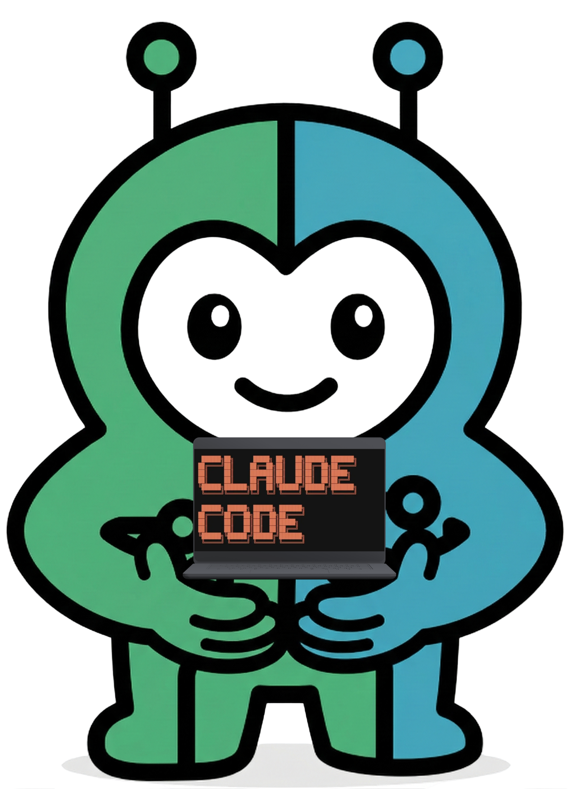

# symbi-claude-code

<p align="center">
  
</p>

Optional local policy hooks for Claude Code and Cursor, with a shared Python
engine and an optional Symbiont Cedar evaluator. Installing the plugin enables
its checks; it does not activate a different default agent.

**Local hooks are not a containment boundary.** They can block supported tool
requests, but arbitrary shell commands, external MCP tools, directory searches,
changes made outside the hook, and harness configuration can bypass path-based
checks. Use Symbiont's governed runtime for isolated execution and protected
journals in secure or regulated deployments.

## Install

Requirements: Bash, **Python 3.11+** (`python3` on PATH), and **Claude Code 2.1.295+** or Cursor.
No Python packages or `jq` are required. An unavailable engine blocks guarded
calls; there is no limited-parser fallback. Claude Code hook startup failures and
timeouts also block through `onFailure: block`; older clients are unsupported.

In Claude Code, add the marketplace **and install the plugin**:

```text
/plugin marketplace add https://github.com/thirdkeyai/symbi-claude-code
/plugin install symbi@symbi-marketplace
```

See the [plugin installation reference](https://code.claude.com/docs/en/discover-plugins).
Restart or reload plugins as directed by your installed harness. Run
`/symbi:symbi-status` to check the installation.

For Cursor, keep this checkout in an operator-controlled location, then run:

```sh
bash /path/to/symbi-claude-code/adapters/cursor/install.sh /path/to/project
```

The installer merges existing hooks, saves a backup, binds the policy directory
to that project, and registers `preToolUse` with `failClosed: true`. Re-run it
when upgrading an existing installation. Paths containing spaces and quotes are
supported. Cursor's current `preToolUse` does not enforce `ask`, so a balanced-mode
sudo warning **blocks** there with manual-review guidance. The dedicated
`beforeShellExecution` event can return `ask` when separately configured.
See the [Cursor hook contract](https://cursor.com/docs/hooks).

## What is checked

- Direct read paths: `.env` and `.env.*`, credential directories, package-manager
  credentials, private-key filenames, and common framework secrets. Template
  files `.env.example`, `.env.sample`, and `.env.test` are exempt.
- Direct write paths: the same rules plus CI workflows and plugin control files.
  Policy, hook configuration, the plugin installation, and local diagnostic state
  require operator changes outside the agent session, even in permissive mode.
- Bash/Shell strings: common destructive-command patterns, including matching
  commands within chains. These are heuristics, not shell interpretation or
  filesystem mediation. For example, reading a secret through a shell program is
  not prevented by the direct-file rule.
- Every tool event reaches configured Cedar policies, including search and MCP
  calls. Built-in path checks inspect the supplied path, not every descendant a
  search tool might read. Unsupported tools have no built-in effect model.

Relative paths, traversal spellings and existing symlinks are checked against both
lexical and resolved paths. This is a point-in-time check, not protection against
concurrent filesystem replacement. Malformed JSON, duplicate keys, invalid
argument types, malformed TOML, and evaluator failures block the call.

`SYMBIONT_MANAGED` has no bypass effect. A caller-provided environment flag cannot
prove that an outer runtime provides isolation.

## Customize and opt out

`/symbi:symbi-protect` explains the active rules and provides an operator-applied
starter policy. Edit `.symbiont/local-policy.toml` outside the agent session:

```toml
[mode]
mode = "balanced"       # built-ins active; sudo warns in Claude Code
# mode = "strict"       # also deny sudo
# mode = "permissive"   # disable built-ins; retain local deny/control/Cedar checks

[deny]
paths = ["private/", "*.backup"]
commands = ["forbidden-command"]
branches = ["main", "production"]

[allow]
paths = [".env.template"]
commands = ["sudo systemctl status myapp"]
```

TOML arrays may span lines and use standard TOML quoting. Unknown sections and
keys are errors; the old, unenforced `[require_approval]` section is unsupported.
Path denies retain glob and substring matching. Path exceptions use globs.
Command strings are limited to 64 KiB so local checks remain bounded.
Command denies are substrings; command exceptions must match the **entire** string.
Local denies take precedence over exceptions. Exceptions only relax built-ins;
they cannot override control-path protection or Cedar.

To opt out, the operator can disable/uninstall the plugin in the harness, or run
this in a separate terminal at the project root:

```sh
mkdir -p .symbiont
touch .symbiont/disabled
# Re-enable:
rm .symbiont/disabled
```

The namespaced disable/enable commands show these instructions; they do not ask
the agent to mutate its own controls. A marker suppresses decisions and logging
for valid calls. Invalid hook input remains an error.

## Optional runtime integration

Install a current `symbi` binary built with Cedar and confirm `symbi --version`.
The bundled `install.sh` installs the runtime through Cargo; the hooks themselves
do not require it unless you configure Cedar policies.

A project with a `policies/` directory opts into required Cedar evaluation. It
must contain at least one effective `.cedar` policy. Missing runtime support,
empty policy sets, timeouts (two seconds), and malformed or unrecognized results
block calls. Removing the directory outside the session opts out of this layer.

The plugin sends the original `tool_name` and full `tool_input` to:

```sh
symbi policy evaluate --stdin --json --policies /absolute/project/policies
```

Policies use `Symbi::Agent::"claude-code"`,
`Symbi::Action::"tool_call::<native tool name>"`,
`Symbi::Resource::"default"`, and `context.tool_input`. The current CLI principal
is fixed even for Cursor; it is not a verified per-user identity. Cursor's shell
action is `tool_call::Shell`; Claude Code's is `tool_call::Bash`.
See [policy guidance](skills/symbi-policy/SKILL.md).

The integration requires the current CLI's structured positive-policy response.
A build without Cedar returns a default allow that the plugin deliberately
rejects. Older or changed CLI response contracts need a compatible plugin update.

Runtime MCP tools are also opt-in: after installing `symbi`, merge the sample
[server entry](examples/standalone/runtime-mcp.json) into the project MCP
configuration outside the agent session. The plugin does not start an MCP server
automatically. Review existing servers before changing that configuration.

Configuration pins and schema signatures are different checks:

- `symbi schemapin pin/verify --mcp-server NAME --config .mcp.json` records or checks
  a hash of the local server configuration. It does not fetch schemas or prove
  publisher identity. Session startup checks up to three pins when the runtime
  is available, reporting failures; this is not an MCP execution gate.
- MCP `verify_schema` accepts supplied schema content and a public-key URL for
  separate signature verification. There is no `pin_schema` MCP tool.

## Governed execution for secure environments

Managed CLI workers run under Symbiont with built-in tools and plugin discovery
disabled. They access exact registered ToolClad tools through private brokers.
This plugin is not loaded inside those workers.

For Linux desktop/laptop development without Docker or a VM, start from
`symbi init --sandbox landlock --profile dev-agent` as described in the
[managed example](examples/cli-executor/README.md). The runtime verifies kernel,
namespace and supervision prerequisites and keeps source access, approvals,
provider credentials and signed journals outside the worker's authority.
Other native OS backends are outside this workflow.

## Commands and diagnostics

Commands use the `symbi` namespace, for example `/symbi:symbi-audit`.

| Command suffix | Purpose |
| --- | --- |
| `symbi-protect`, `symbi-disable`, `symbi-enable` | Operator-managed local policy and opt-out instructions |
| `symbi-status`, `symbi-audit` | Check prerequisites and inspect local records |
| `symbi-init`, `symbi-agent-sdk` | Explain and scaffold the supported runtime workflow |
| `symbi-policy`, `symbi-dsl` | Draft policies and validate agent syntax |
| `symbi-pin`, `symbi-verify` | Configuration pinning and separate schema verification |

Local records live in `.symbiont/audit/tool-usage.jsonl`. Guard decisions include
an input digest and optional tool-use ID; Claude Code post hooks add completion
records. Raw arguments are not logged. Cursor currently records decisions only.
These files are mutable diagnostics, can be incomplete, and are not compliance
evidence or a cryptographic journal. An allowed decision is not proof of execution.
The runtime's signed journal is a separate artifact from an actual governed run.

## Validation

[Plugin checks](https://github.com/ThirdKeyAI/symbi-claude-code/actions/workflows/plugin-checks.yml)
run on pushes and pull requests using Python **3.11 and 3.14** on Ubuntu. CI checks
shell syntax, ShellCheck, Python compilation and the focused regression suite.
Run the suite locally with Bash and Python 3.11+:

```sh
bash tests/run-tests.sh
```

It covers existing rules, parser attacks, failures, both adapters, control paths,
runtime payload preservation and installer merging. No runtime installation or
third-party Python packages are needed for this suite.

The separate E2E checks require a current `symbi` binary; the installed-client
check also requires Claude Code 2.1.295+:

```sh
python3 -I tests/runtime_e2e.py /absolute/path/to/symbi
python3 -I tests/harness_e2e.py /absolute/path/to/claude /absolute/path/to/symbi
```

The runtime check exercises actual policy allow/deny decisions, nested arguments
and invalid policies. The installed-client check uses a local synthetic provider
and temporary configuration to verify an allowed read, a Cedar denial, and
blocking on missing or timed-out hooks. Neither uses account credentials or an
external model service. The installed-client check passed on Claude Code 2.1.296.
Cursor adapter contracts are tested directly; installed Cursor UI qualification
remains outstanding. These E2E checks run separately from the CI matrix.

## Dependency maintenance

The policy engine uses the Python standard library. CI actions are pinned to
exact commit SHAs, and [Dependabot](.github/dependabot.yml) checks them weekly.
Dependency PRs run the same Python test matrix. Major action updates also need a
compatibility review of the workflow's inputs, runner requirements and triggers
before merging.

Licensed under [Apache-2.0](LICENSE).
